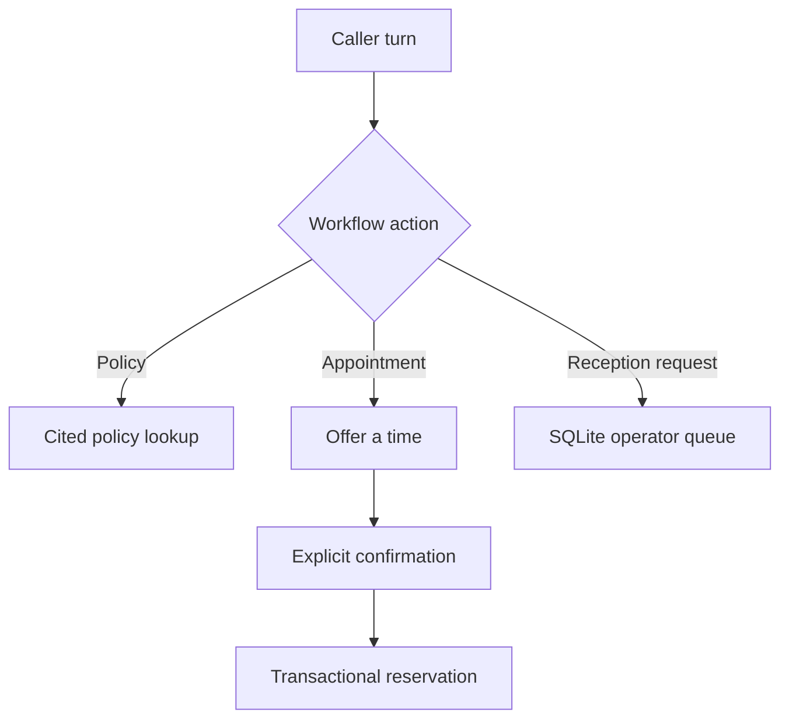

# Clinic Reception Agent

A portfolio workflow for Arabic and English clinic reception. The knowledge
base contains three fictional administrative policies. A lookup returns the
approved text and its source ID. The agent should name that policy when
answering. The workflow handles administrative reception only.



## Run the offline replay

```bash
uv sync --locked --group dev
uv run python src/clinic_demo.py
uv run pytest
```

The replay covers an Arabic policy, an available time, a booking confirmation
and a queued reception request. References are generated at runtime. All
inputs are synthetic and no external service is contacted.

## Run with LiveKit

1. Set up a disposable LiveKit project following [the upstream setup guide](UPSTREAM_README.md).
2. Add `CLINIC_DEMO_DB=clinic-demo.sqlite3` to your ignored `.env.local`.
3. Use the default English speech profile or point `VOICE_PROFILE` to a local
   copy of `examples/voice-profile.json` with `"language": "ar"` for Arabic STT.
   Restart the worker when switching profiles. The text workflow accepts both
   languages.
4. Start with `uv run python src/agent.py dev` and connect via LiveKit Agent
   Console. Ask about arrival, ask for an appointment, pick an available slot,
   and say `confirm booking` or `أكد الحجز` when prompted. Ask for
   `human reception` or `موظف الاستقبال` to enqueue an operator request.
5. Inspect the operator queue with `uv run python src/clinic.py clinic-demo.sqlite3`.
   Each database has two bookable times for the next day. Use a fresh database
   for repeat booking simulations.

The [clinic scenarios](../scenarios.clinic.yaml) cover English booking and an
Arabic policy question. Point the LiveKit CLI at the configured clinic worker
and run `lk agent simulate text --scenarios scenarios.clinic.yaml`. The offline
suite checks LiveKit tool registration and the completed-turn hook without
contacting a model provider. Live voice, provider behavior, Arabic pronunciation
and simulation scoring require separate connected runs.

## State and verification

- LiveKit owns media and transcription. The adapter exposes typed read and
  proposal tools. Booking and queue writes originate from an exact phrase
  in the caller's completed transcript, outside the model's tool surface.
- A proposal expires after two minutes and is cleared by the next caller turn.
  The prompt tells the model to read back the selected slot. Verify that readback
  in connected simulation.
- The database serializes booking writes and enforces one booking per slot and
  per session. Replaying the same booking for a session returns its original
  reference. Store failures produce explicit unavailable outcomes.
- The queue stores a reference, reason and timestamp and can be read locally.
  Telephony transfer and CRM notifications would require an integration.
- Clinic mode disables the application's transcript journal and exports.
  The database stores workflow records with synthetic LiveKit job identifiers.
  Provider-side handling of audio and conversation data follows project settings.
- This mode uses a local demo calendar and a versioned in-code policy catalog.
  It has no clinical data, external calendar, production tenant model or
  compliance certification.
